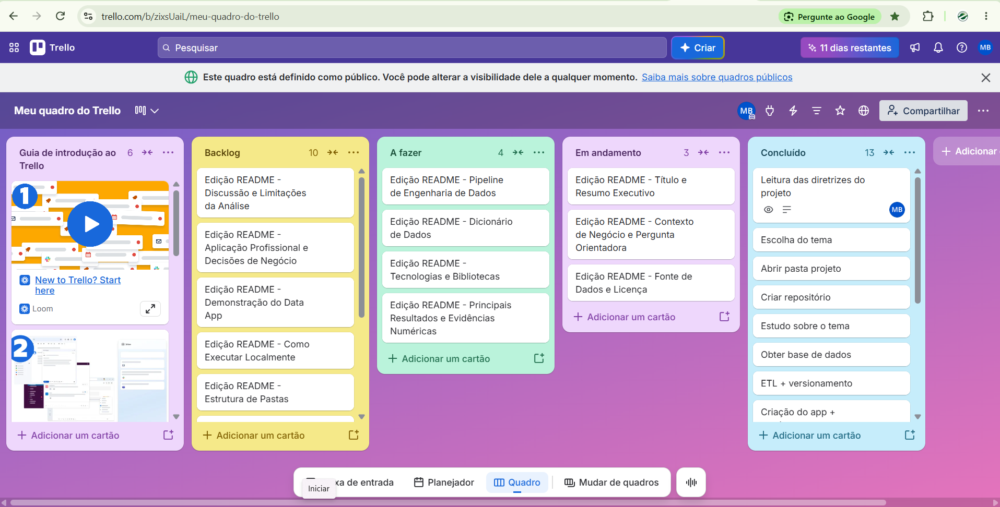

# Projeto_avaliativo_final_M02

Projeto apresentado para apresentação da nota parcial no Módulo 2 - Visualização de Dados - do Curso de Visualização de Dados e Business Intelligence / T2 - SCTEC, 2026.


# 📈 Catarinenses na B3 — Risco e Retorno antes, durante e depois da pandemia

> Data app de Business Intelligence (Python · SQL · Streamlit · Plotly) que compara o desempenho de ações de empresas catarinenses listadas na B3 em três fases:
> **pré-pandemia** (30/12/2019 a 10/03/2020),
> **pandemia** (11/03/2020 a 22/04/2022 - data que decreta o fim da emergência nacional no Brasil), e
> **pós-pandemia** (23/04/2022 a 30/12/2025).

🔗 **App publicado:** https://b3-catarinenses.streamlit.app/

## 1. Título e Resumo Executivo

**Catarinenses na B3** é um painel analítico que informa, com dados diários entre o período de 30/12/2019 a 30/12/2025, o comportamento na B3 das ações de empresas catarinenses. Apesar de inúmeras possibilidades, faremos no presente estudo, uma análise de como esses ativos se comportaram antes, durante e depois da fase aguda da pandemia da covid-19. Quais foram as mais resilientes? Quais mais perderam valor? Quais tiveram melhor recuperação?

O projeto analisa **8 ativos** de empresas com sede em Santa Catarina (WEGE3, EGIE3, INTB3, SHUL4, TUPY3, RANI3, CLSC3 e FIQE3), com pipeline de ETL em Python, base relacional em PostgreSQL (com contingência em SQLite) e dashboard com 6 abas, 4 KPIs, filtros reativos e 7 gráficos interativos.

---

## 2. Contexto de Negócio e Pergunta Orientadora

Qualquer agente atuante no mercado financeiro precisa saber **como cada papel reage em crises e quanto tempo demora a se recuperar**, e não apenas qual rendeu mais. O retorno acumulado esconde o caminho percorrido: um ativo pode terminar bem depois de perder metade do valor no meio do trajeto.

**Pergunta orientadora:** *Entre as ações catarinenses na B3, quais foram mais resilientes, quais mais perderam e quais melhore se recuperaram em cada fase (antes, durante e depois da emergência da covid-19)?*

### Os três períodos e seus marcos

| Período                   | Janela                   | Marco de início                                | Marco de fim                                                                  |
| -------------------------- | ------------------------ | ----------------------------------------------- | ----------------------------------------------------------------------------- |
| **1. Pré-pandemia** | 30/12/2019 → 10/03/2020 | Início da série de dados                      | Véspera da declaração de pandemia pela OMS                                 |
| **2. Pandemia**      | 10/03/2020 → 22/04/2022 | OMS declara a pandemia (11/03/2020)             | Brasil encerra a emergência nacional (Portaria GM/MS nº 913, de 22/04/2022) |
| **3. Pós-pandemia** | 22/04/2022 → 30/12/2025 | Fim da emergência nacional decretada no Brasil | Fim da série de dados                                                        |

> ### 🇧🇷 O Brasil encerrou a emergência antes da OMS
>
> A **Portaria GM/MS nº 913, de 22/04/2022**, encerrou a Emergência em Saúde Pública de Importância Nacional (Espin) no Brasil, com perda do status 30 dias depois (22/05/2022). A **OMS só encerrou a emergência de saúde pública de importância internacional em 05/05/2023, 378 dias depois**, e não revogou o termo "pandemia", declarado em 11/03/2020. Por isso, o período 3 contém 378 dias (22/04/2022 a 05/05/2023) em que a emergência internacional ainda estava em vigor.

Obs: para a presente análise, consideraremos a data decretada pelo governo brasileiro para o fim da pandemia. Nada impede, no entanto, do usuário analisar os dados de acordo com as diretrizes da OMS. Esta é a razão do app não ter o filtro com períodos previamente definidos.

### Como definimos os três destaques

| Destaque                          | Definição                                                                              |
| --------------------------------- | ---------------------------------------------------------------------------------------- |
| 🛡️ **Maior resiliência** | Menor drawdown máximo no período (menor queda de pico a vale)                          |
| 📉 **Maior prejuízo**      | Pior retorno no período (perda líquida); o pior drawdown é informado como complemento |
| 🔄 **Maior recuperação**  | Valorização do menor preço do período até o último dia do período                 |

Os destaques consideram apenas ativos **líquidos e com histórico completo no período**: a CLSC3 é excluída pelo alerta de liquidez (vide 7.8), e INTB3 e FIQE3 só entram no período 3, pós-pandemia, quando começam a atuar na B3.

Perguntas específicas respondidas pelo painel:

1. Qual a rentabilidade comparativa normalizada (Base 100) de cada ativo?
2. Quais ativos entregaram a melhor relação retorno/risco (Índice de Sharpe)?
3. Como se distribuem os retornos diários (dispersão, assimetria e caudas)?
4. Qual o drawdown máximo de cada papel e qual foi o mais resiliente?
5. Como o preço se comportou frente às médias móveis de 21 e 50 dias?

---

## 3. Fonte de Dados e Licença

| Item                            | Descrição                                                                              |
| ------------------------------- | ---------------------------------------------------------------------------------------- |
| **Origem**                | Yahoo Finance, acessado pela biblioteca Python `yfinance` (sufixo `.SA` para a B3)   |
| **Período**              | 30/12/2019 a 30/12/2025 (datas inclusivas)                                               |
| **Frequência**           | Diária (pregões)                                                                       |
| **Variáveis**            | Data, Abertura, Máxima, Mínima, Fechamento, Fechamento Ajustado e Volume               |
| **Método de extração** | `yf.Ticker("<ticker>.SA").history(auto_adjust=False)`, com até 3 tentativas por ativo |

**Licença e uso.** O `yfinance` é uma biblioteca de código aberto (licença Apache 2.0) e não é afiliada ao Yahoo. Os dados de mercado pertencem ao Yahoo e a suas fontes, e o uso é destinado a **fins educacionais e de pesquisa**; os direitos sobre os dados baixados seguem os termos de uso do Yahoo. Este repositório é um trabalho acadêmico e não oferece recomendação de investimento.

**Observação sobre "fonte oficial".** O Yahoo Finance é um agregador, não a fonte primária. A fonte oficial dos preços é a B3 (arquivo COTAHIST). Diferenças pontuais de ajuste entre as duas fontes são possíveis (ver seção 8).

---

## 4. Pipeline de Engenharia de Dados

```
Yahoo Finance ──► etl.py (extrair → tratar → carregar) ──► PostgreSQL (Neon)  ──► app.py (Streamlit)
                                                     └──► SQLite (data/*.db, contingência)
```

Todo o ETL está em `etl.py` e roda com `python etl.py` (SQLite) ou `python etl.py --postgres`.

**Extração.** Um ativo por vez, com 3 tentativas e espera crescente (2 s, 4 s, 6 s). Falha em um ativo não interrompe os demais.

**Limpeza e validação** (por ativo, com relatório de qualidade gravado na tabela `meta_qualidade`):

1. Remoção do fuso horário e normalização das datas.
2. Remoção de datas duplicadas (mantém a última).
3. Conversão de colunas para numérico.
4. Recorte estrito no período do projeto.
5. Remoção de linhas sem preço de fechamento ou fechamento ajustado.
6. Remoção de linhas com algum preço ≤ 0.
7. Remoção de linhas inconsistentes (máxima < mínima).
8. Volume nulo vira 0 e volume negativo é truncado em 0.
9. Sinalização (sem remover) de retornos diários acima de 40% em módulo.

**Campos derivados:** `volume_financeiro = volume × fechamento` (aproximação em R$) e `retorno_diario`, a variação percentual do fechamento ajustado frente ao pregão anterior.

**Modelagem dimensional (esquema estrela):** `dim_ativo` e `dim_calendario` descrevem os eixos de análise, e `fact_cotacao` guarda as medidas diárias, com chave primária composta `(id_ativo, data)`. A carga é feita em transação: grava tudo ou nada. Foram carregadas **11.297 cotações**.

**Exclusão da Casan.** Inicialmente, verificou-se que a CASAN (Companhia Catarinense de Águas e Saneamento) tivesse atuação na B3. No entanto, os ativos CASN3 e CASN4 foram testados, mas **não retornaram histórico no Yahoo Finance** (`HTTP 404` / "Data doesn't exist"). Por isso, foram excluídos da base de dados do presente estudo.

**SQL analítico:** o arquivo `queries.sql` traz 5 consultas (Base 100, risco/retorno, distribuição, drawdown e médias móveis) equivalentes aos cálculos feitos em Pandas, e é exibido na aba *Dados* do app.

---

## 5. Dicionário de Dados

### `dim_ativo`

| Coluna        | Tipo         | Significado                                    |
| ------------- | ------------ | ---------------------------------------------- |
| `id_ativo`  | INTEGER (PK) | Identificador do papel                         |
| `ticker`    | VARCHAR(10)  | Código de negociação na B3 (ex.: WEGE3)     |
| `ticker_yf` | VARCHAR(15)  | Código usado na extração (ticker + `.SA`) |
| `empresa`   | VARCHAR(80)  | Nome da companhia                              |
| `setor`     | VARCHAR(60)  | Setor de atuação                             |

### `dim_calendario`

| Coluna                          | Tipo      | Significado                                |
| ------------------------------- | --------- | ------------------------------------------ |
| `data`                        | DATE (PK) | Data do pregão                            |
| `ano`, `trimestre`, `mes` | INTEGER   | Atributos de calendário para agregações |
| `dia_semana`                  | INTEGER   | 0 = segunda-feira … 4 = sexta-feira       |

### `fact_cotacao`

| Coluna                  | Tipo         | Significado financeiro                                                              |
| ----------------------- | ------------ | ----------------------------------------------------------------------------------- |
| `id_ativo`            | INTEGER (FK) | Ativo negociado                                                                     |
| `data`                | DATE (FK)    | Dia do pregão                                                                      |
| `abertura`            | DOUBLE       | Preço do primeiro negócio do dia (R$)                                             |
| `maxima` / `minima` | DOUBLE       | Maior e menor preço negociado no dia (R$)                                          |
| `fechamento`          | DOUBLE       | Preço de fechamento sem ajuste por proventos (R$)                                  |
| `fech_ajustado`       | DOUBLE       | Fechamento ajustado por dividendos e desdobramentos; é a base de todos os retornos |
| `volume`              | BIGINT       | Quantidade de ações negociadas                                                    |
| `volume_financeiro`   | DOUBLE       | `volume × fechamento`: proxy do giro financeiro (R$)                             |
| `retorno_diario`      | DOUBLE       | Variação do `fech_ajustado` frente ao pregão anterior (decimal)                |

### `meta_qualidade`

| Coluna                                                | Tipo    | Significado                                    |
| ----------------------------------------------------- | ------- | ---------------------------------------------- |
| `ticker`                                            | VARCHAR | Ativo                                          |
| `linhas_brutas` / `linhas_finais` / `removidas` | INTEGER | Linhas antes e depois da limpeza               |
| `outliers_retorno`                                  | INTEGER | Dias com variação acima de 40% (sinalizados) |
| `data_inicio` / `data_fim`                        | VARCHAR | Primeira e última cotação disponível       |

### Métricas calculadas no app

| Métrica                                                                           | Definição                                                                                                     |
| ---------------------------------------------------------------------------------- | --------------------------------------------------------------------------------------------------------------- |
| Base 100                                                                           | `fech_ajustado / primeiro fech_ajustado do período × 100`                                                   |
| Retorno acumulado                                                                  | `P_final / P_inicial − 1`                                                                                    |
| Volatilidade anualizada                                                            | desvio-padrão dos retornos diários × √252                                                                   |
| Índice de Sharpe                                                                  | `(retorno anualizado − taxa livre de risco) / volatilidade anualizada`; taxa padrão de 10% a.a., ajustável |
| Drawdown                                                                           | `P_t / máximo acumulado até t − 1`; o drawdown máximo é o mínimo da série                              |
| Recuperação do fundo (calculada em `analise_periodos.py`, não exibida no app) | `P_final / P_mínimo do período − 1`: valorização do menor preço do período até o último dia          |
| VaR 95% / CVaR 95%                                                                 | quantil de 5% dos retornos diários / média dos retornos iguais ou piores que ele                              |
| SMA 21 e SMA 50                                                                    | média móvel simples do fechamento ajustado                                                                    |

---

## 6. Tecnologias e Bibliotecas

| Ferramenta                          | Uso e justificativa                                                                                     |
| ----------------------------------- | ------------------------------------------------------------------------------------------------------- |
| **Python 3**                  | Linguagem única para ETL e aplicação, com ecossistema consolidado em dados financeiros               |
| **pandas / NumPy**            | Limpeza, séries temporais e cálculo de métricas (retornos, rolling, quantis)                         |
| **yfinance**                  | Acesso programático e gratuito ao histórico diário das ações da B3                                 |
| **SQLAlchemy**                | Camada única de acesso que funciona com PostgreSQL e SQLite sem mudar o código                        |
| **PostgreSQL (Neon)**         | Banco relacional em nuvem, gratuito, para o modelo dimensional e as consultas SQL                       |
| **SQLite**                    | Contingência local versionada no repositório: o app continua funcionando se a nuvem falhar            |
| **psycopg2-binary**           | Driver de conexão com o PostgreSQL                                                                     |
| **Streamlit**                 | Interface web em Python puro, com cache, estado de sessão, abas e deploy gratuito                      |
| **Plotly Express**            | Gráficos interativos (hover, zoom, exportação em imagem)                                             |
| **Git / GitHub (GitFlow)**    | Versionamento com branches `main`, `develop` e `feature/*`, commits semânticos e tags de release |
| **Streamlit Community Cloud** | Hospedagem pública do app, com gestão de segredos                                                     |
| **Trello**                    | Planejamento ágil em quadro Kanban                                                                     |

---

## 7. Principais Resultados e Evidências Numéricas

**Principais achados (quadro-resumo):**

- **Maior resiliência: EGIE3, nos três períodos**, com os menores drawdowns máximos (−17,2%, −23,8% e −24,0%).
- **Maior prejuízo:** na pré-pandemia (−27,4%): **TUPY3** | na pandemia: nenhum ativo líquido terminou no negativo, mas a **SHUL4** sofreu a maior perda de pico a vale (−53,7%) | na pós-pandemia: a **INTB3** (−53,0% no período, com drawdown de −67,4%).
- **Maior recuperação:** SHUL4 na pandemia: ** SHUL4** (+239,5% desde o fundo de 03/04/2020) |  na pós-pandemia: **FIQE3** (+147,0% desde o fundo de 14/02/2023).
- **Resiliência não é recuperação rápida:** a EGIE3, a mais resiliente, só voltou ao seu pico de janeiro de 2020 em 14/06/2023, enquanto a WEGE3 voltou em 26/06/2020.
- **O Brasil encerrou a emergência 378 dias antes da OMS** (vide seção 2).

### 7.1 Períodos analisados

| Período                | Janela                   | Pregões | Filtro de datas no app  |
| ----------------------- | ------------------------ | -------: | ----------------------- |
| **Pré-pandemia** | 30/12/2019 → 10/03/2020 |       47 | 30/12/2019 a 10/03/2020 |
| **Pandemia**      | 10/03/2020 → 22/04/2022 |      524 | 10/03/2020 a 22/04/2022 |
| **Pós-pandemia** | 22/04/2022 → 30/12/2025 |      923 | 22/04/2022 a 30/12/2025 |

As janelas compartilham a data de fronteira (o fechamento de uma é a base da seguinte), então os retornos se encadeiam e batem com o retorno do período completo. Todos os retornos usam o **fechamento ajustado**.

O app não tem atalhos para esses períodos: ele mantém a análise livre para o usuário explorar outros recortes. Para reproduzir uma janela, digite as datas acima no filtro de período da barra lateral.

### 7.2 Retorno por período (%)

| Ativo                            |  Pré-pandemia |        Pandemia |   Pós-pandemia |
| -------------------------------- | -------------: | --------------: | --------------: |
| *Pregões*                     |         *47* |         *524* |         *923* |
| WEGE3                            |          +21,3 |           +53,1 |           +70,7 |
| SHUL4                            |          +26,1 |           +57,1 |           +42,5 |
| RANI3                            |           +2,5 |           +74,4 |           +83,1 |
| EGIE3                            |          −7,5 |            +3,3 |           +26,1 |
| TUPY3                            |         −27,4 |            +6,0 |          −26,1 |
| **Média dos 5 líquidos** | **+3,0** | **+38,8** | **+39,3** |
| INTB3                            |            n/d |          +52,9* |          −53,0 |
| FIQE3                            |            n/d |         −38,8* |           +37,6 |
| CLSC3 ⚠️                       |          +19,9 |           +15,3 |          +189,1 |

\* parcial: INTB3 estreou em 08/02/2021 e FIQE3, em 29/07/2021, então seus números do período pandêmico cobrem só parte da janela e não são comparáveis.

### 7.3 Destaques: resiliência, prejuízo e recuperação

| Período                                        | 🛡️ Maior resiliência(menor drawdown máx.) | 📉 Maior prejuízo(pior retorno no período)                                                                             | 🔄 Maior recuperação(do fundo ao fim do período)                                                             |
| ----------------------------------------------- | --------------------------------------------- | ------------------------------------------------------------------------------------------------------------------------ | --------------------------------------------------------------------------------------------------------------- |
| **Pré-pandemia**30/12/2019 → 10/03/2020 | **EGIE3** (−17,2%)                     | **TUPY3** (−27,4%)Pior drawdown: RANI3 (−45,4%)                                                                  | não se aplica: o período termina em plena quedaMaior alta: SHUL4 (+26,1%)                                     |
| **Pandemia**10/03/2020 → 22/04/2022      | **EGIE3** (−23,8%)                     | nenhum ativo líquido fechou o período no negativo (pior retorno: EGIE3, +3,3%)Pior drawdown: **SHUL4** (−53,7%) | **SHUL4** (+239,5% desde o fundo de 03/04/2020)                                                           |
| **Pós-pandemia**22/04/2022 → 30/12/2025 | **EGIE3** (−24,0%)                     | **INTB3** (−53,0%)Pior drawdown: INTB3 (−67,4%)                                                                  | **FIQE3** (+147,0% desde o fundo de 14/02/2023)Entre os 5 líquidos presentes desde 2019: WEGE3 (+134,1%) |

**Interpretação.**

- **Resiliência e retorno são coisas diferentes.** A EGIE3 foi a ação que melhor suportou os períodos de crise, mas também foi a que apresentou menor valorização durante a pandemia. No pós-pandemia, teve a menor queda (24%), mas seu retorno também foi modesto..
- **Terminar no positivo não significa que não houve grandes perdas. Todas as ações terminaram a pandemia com ganhos, mas a SHUL4 chegou a perder 53,7% do seu valor antes de se recuperar.
- **No pós-pandemia, o maior prejuízo é de um ativo que nem existia no pré e na pandemia:** A maior perda no pós-pandemia foi da INTB3. A ação caiu 53% e atingiu seu menor preço próximo ao final do período analisado.
- **A "maior recuperação" depende da data do fundo.** Uma grande recuperação depende do momento da compra. O cálculo considera quanto alguém teria ganhado se tivesse comprado exatamente no menor preço da ação. Como é praticamente impossível acertar esse momento, também é importante avaliar quanto tempo a ação levou para recuperar seu preço anterior.

Em resumo: uma ação pode ser mais resistente às crises, mas render menos. Também pode terminar um período com lucro mesmo depois de sofrer grandes quedas. Por isso, é importante avaliar tanto os ganhos quanto as perdas e o tempo necessário para se recuperar.

### 7.4 Dentro da pandemia (período 2)

O período 2 não é homogêneo. Para os cinco ativos líquidos, ele reúne uma queda, um rali e uma fase final lateral:

| Ativo            | Queda inicial10/03 → 23/03/2020 | Rali23/03/2020 → 30/12/2021 | Fase final30/12/2021 → 22/04/2022 |
| ---------------- | -------------------------------: | ---------------------------: | ---------------------------------: |
| WEGE3            |                           −15,9 |                        +90,2 |                              −4,3 |
| SHUL4            |                           −44,2 |                       +147,6 |                              +13,8 |
| RANI3            |                           −38,0 |                       +191,7 |                              −3,5 |
| EGIE3            |                           −19,2 |                        +10,0 |                              +16,2 |
| TUPY3            |                           −40,4 |                        +86,2 |                              −4,4 |
| **Média** |                 **−31,6** |             **+105,1** |                     **+3,6** |

A média dos cinco foi de **−31,6%** na queda inicial, **+105,1%** no rali e **+3,6%** na fase final.

O período de rali pode ser justificado pela possível recuperação das empresas proporcionada pelos juros baixos, estímulos econômicos, liquidez abundante, retomada industrial e valorização de commodities, que impulsionaram os preços das ações, criando uma euforia no mercado financeiro logo após o cenário de choque e de incerteza geradas no início da pandemia

**Tempo para recuperar o pico pré-crise** (primeiro fechamento ajustado igual ou acima do máximo atingido até 10/03/2020):

| Ativo | Pico pré-crise | Fundo na pandemia | Voltou ao pico em | Dias do fundo até a recuperação | Meses desde o pico |
| ----- | --------------- | ----------------- | ----------------- | ---------------------------------: | -----------------: |
| WEGE3 | 21/02/2020      | 18/03/2020        | 26/06/2020        |                                100 |                4,1 |
| SHUL4 | 21/02/2020      | 03/04/2020        | 05/04/2021        |                                367 |               13,4 |
| RANI3 | 10/02/2020      | 23/03/2020        | 30/04/2021        |                                403 |               14,6 |
| TUPY3 | 14/01/2020      | 20/03/2020        | 08/08/2022        |                                871 |               30,8 |
| EGIE3 | 14/01/2020      | 13/05/2020        | 14/06/2023        |                              1.127 |               41,0 |

**Interpretação.** A WEGE3 se recuperou muito mais rápido, levando apenas 100 dias para voltar ao preço que tinha antes da queda. Já a EGIE3, apesar de ter sofrido uma queda menor, demorou 1.127 dias (cerca de 3 anos) para recuperar seu preço anterior, o que só aconteceu no período pós-pandemia.

Em resumo: sofrer uma queda menor não significa necessariamente se recuperar mais rápido. A EGIE3 foi mais resistente à queda, mas a WEGE3 recuperou seu valor em menos tempo.

### 7.5 Risco por período

| Ativo      | Vol. Pré | Vol. Pand. | Vol. Pós | Sharpe Pand. | Sharpe Pós | DD máx. Pré | DD máx. Pand. | DD máx. Pós |
| ---------- | --------: | ---------: | --------: | -----------: | ----------: | ------------: | -------------: | ------------: |
| WEGE3      |     59,1% |      45,4% |     29,2% |         0,27 |        0,19 |       −19,9% |        −37,3% |       −38,2% |
| SHUL4      |     70,6% |      46,4% |     28,1% |         0,30 |        0,00 |       −29,0% |        −53,7% |       −37,5% |
| RANI3      |    114,0% |      61,9% |     31,1% |         0,32 |        0,25 |       −45,4% |        −39,4% |       −46,9% |
| EGIE3      |     33,5% |      26,8% |     19,9% |       −0,32 |      −0,18 |       −17,2% |        −23,8% |       −24,0% |
| TUPY3      |     47,5% |      46,1% |     31,7% |       −0,16 |      −0,56 |       −33,7% |        −42,9% |       −58,2% |
| INTB3      |       n/d |     40,3%* |     36,3% |         n/d* |      −0,78 |           n/d |       −29,1%* |       −67,4% |
| FIQE3      |       n/d |     60,8%* |     37,2% |         n/d* |      −0,03 |           n/d |       −46,5%* |       −45,0% |
| CLSC3 ⚠️ |     34,4% |      43,2% |     24,7% |       −0,07 |        0,95 |          0,0% |        −36,7% |       −17,9% |

\* parcial (INTB3 e FIQE3 só têm dados na segunda metade do período pandêmico).

**Interpretação.**

- **Menos oscilações, mas ainda com grandes perdas:** depois da pandemia, as ações ficaram menos instáveis, mas continuaram apresentando quedas expressivas. Em 2025, todas tiveram suas maiores perdas do período pós-pandemia. A TUPY3 foi a mais afetada, chegando a perder 58,2% do seu valor.
- **O retorno não compensou o risco:** mesmo considerando uma taxa de referência de 10% ao ano, os ganhos das ações foram baixos diante dos riscos assumidos pelos investidores.

Em resumo: mesmo após a pandemia, quando as ações passaram a oscilar menos, o risco de grandes perdas continuou existindo, e os retornos não foram suficientes para compensar esse risco.

### 7.6 Período completo (30/12/2019 → 30/12/2025): risco, retorno e Sharpe (taxa livre de risco 10% a.a.)

| Ativo      | Retorno acum. | Retorno anualizado | Volatilidade a.a. | Sharpe | Drawdown máx. | Data do fundo |
| ---------- | ------------: | -----------------: | ----------------: | -----: | -------------: | ------------- |
| CLSC3 ⚠️ |       +299,4% |              25,9% |             32,6% |   0,49 |        −45,7% | 23/03/2023    |
| WEGE3      |       +217,0% |              21,2% |             36,9% |   0,30 |        −49,5% | 17/06/2022    |
| RANI3      |       +227,3% |              21,8% |             48,4% |   0,24 |        −62,6% | 23/03/2020    |
| SHUL4      |       +182,3% |              18,9% |             37,4% |   0,24 |        −64,4% | 03/04/2020    |
| EGIE3      |        +20,5% |               3,2% |             23,0% | −0,30 |        −32,1% | 13/05/2020    |
| FIQE3      |       −15,8% |             −3,8% |             42,0% | −0,33 |        −65,9% | 14/02/2023    |
| INTB3      |       −28,1% |             −6,5% |             37,4% | −0,44 |        −67,4% | 10/10/2025    |
| TUPY3      |       −43,1% |             −9,0% |             37,9% | −0,50 |        −60,8% | 20/03/2020    |

**Interpretação.**

- **Poucas ações superaram a taxa de referência:** apenas quatro (CLSC3, WEGE3, RANI3 e SHUL4) tiveram retorno acima de 10% ao ano. Entre as ações mais negociadas, a WEGE3 apresentou o melhor resultado em relação ao risco assumido.
- **A EGIE3 foi a mais estável, mas rendeu pouco:** sofreu quedas menores e apresentou menos oscilações, porém seu retorno médio anual foi de apenas 3,2%, abaixo dos 10% da taxa de referência.
- **A WEGE3 também apresentou grandes riscos após a pandemia:** sua maior queda ocorreu em junho de 2022, chegando a 49,5%, superando a perda registrada no início da pandemia.
- INTB3 e FIQE3 tiveram suas maiores quedas em períodos mais recentes: como essas ações não existiam em 2020, suas perdas não estão relacionadas diretamente à crise da pandemia.

Em resumo: a ação mais estável nem sempre é a mais rentável, e mesmo empresas consideradas sólidas podem sofrer grandes perdas fora de períodos de crise.

### 7.7 ⚠️ Alerta de qualidade: CLSC3

- **A CLSC3 (Celesc ON) tem pouquíssimas negociações na Bolsa, ou seja, é uma ação com baixa liquidez:** em 62,3% dos pregões do período completo o volume é zero (95,8% no período pré-pandemia, 73,5% no pandêmico e 54,3% no pós-pandemia); em 66,6%, o retorno é exatamente zero, e em 79,9%, abertura, máxima, mínima e fechamento são idênticas. Em março de 2020 não houve negócio e o preço ficou parado em R$ 56,00.
- Seu volume financeiro médio foi de apenas R$ 24 mil por dia, enquanto o da WEGE3 foi de aproximadamente R$ 313 milhões.
- A valorização de 299,4% no período pode parecer muito atraente, mas não representa necessariamente um ganho que o investidor conseguiria realizar facilmente.
- Como a ação passa muitos dias sem negociação, os indicadores de risco e volatilidade podem apresentar resultados distorcidos, dando uma falsa impressão de estabilidade.

Em resumo: apesar da grande valorização apresentada pela CLSC3, sua baixa liquidez torna os resultados pouco confiáveis para comparação com outras ações. Por isso, o estudo deve priorizar as cinco ações com maior liquidez: WEGE3, EGIE3, SHUL4, TUPY3 e RANI3.

---

## 8. Discussão e Limitações da Análise

- Não é possível afirmar que o fim da emergência nacional causou mudanças nos preços das ações. Embora algumas ações tenham atingido seus menores preços logo depois dessa data, outros fatores, como juros, inflação e cenário econômico, também influenciaram o mercado.
- Observação em relação ao termo "pré-pandemia" aqui mencionado: o fim da emergência nacional não significou o fim da pandemia. O Brasil encerrou a emergência sanitária nacional em abril de 2022, mas a emergência internacional continuou até maio de 2023.
- O período anterior à pandemia já apresentava quedas. Portanto, ele não representa um cenário econômico totalmente normal. Além disso, foi um período curto, o que reduz a confiabilidade de alguns indicadores.
- O período da pandemia teve diferentes momentos: primeiro uma queda, depois uma forte recuperação e, por fim, uma fase de menor valorização. Já o período posterior foi influenciado por diversos outros acontecimentos econômicos.
- A maior recuperação não significa um ganho garantido. O cálculo considera que o investidor comprou a ação exatamente no seu menor preço, algo muito difícil de conseguir na prática.
- Nem todas as empresas possuem dados para todos os períodos. Algumas começaram a negociar na Bolsa somente em 2021, limitando as comparações.
- A baixa liquidez de algumas ações pode distorcer os resultados. Por isso, a CLSC3 foi excluída das principais comparações.
- A quantidade de empresas analisadas é pequena. São apenas oito empresas, e não houve comparação com o Ibovespa. Portanto, não é possível afirmar que elas tiveram desempenho melhor que o mercado em geral.
- Os dados podem apresentar limitações. Foram obtidos no Yahoo Finance, e os ajustes de preços relacionados a dividendos e desdobramentos não foram auditados.
- A taxa de referência foi fixada em 10% ao ano. Entretanto, os juros variaram bastante entre 2020 e 2025, o que pode alterar os resultados dos indicadores.
- Os custos de investimento não foram considerados. Impostos, taxas de corretagem e outros custos podem reduzir os ganhos reais do investidor.

Em resumo: O estudo permite identificar como as ações se comportaram em diferentes períodos, quais apresentaram maiores ganhos, perdas e riscos. Entretanto, os resultados devem ser interpretados como uma análise do comportamento histórico das ações e não como uma prova de que a pandemia causou essas variações ou como uma garantia de desempenho futuro. Também é importante considerar as limitações dos dados, da quantidade de empresas e dos indicadores utilizados antes de tirar conclusões sobre os investimentos.

---

## 9. Aplicação Profissional e Decisões de Negócio

A análise dos riscos das ações ajuda diferentes profissionais a tomar decisões mais seguras:

- **Gestor de investimentos:** deve avaliar não apenas quanto uma ação pode render, mas também quanto pode perder em momentos de crise. Uma ação mais segura pode proteger o patrimônio, mas oferecer um retorno menor.
- **Diretor financeiro:** precisa saber quanto tempo um investimento pode levar para recuperar seu valor após uma queda. Essa informação ajuda a planejar o caixa da empresa e evitar problemas financeiros.
- **Investidor individual:** não deve escolher uma ação apenas pelo retorno acumulado. É importante observar também o tamanho das perdas que ela pode apresentar e o equilíbrio entre risco e retorno.
- **Analista de risco:** pode comparar o comportamento das ações em diferentes períodos para identificar quais foram mais ou menos arriscadas em cada situação.
- **Atenção à liquidez:** uma ação pode apresentar uma valorização muito alta, mas, se tiver poucos compradores e vendedores, pode ser difícil comprá-la ou vendê-la pelo preço desejado.

Em resumo: antes de investir, não basta saber quanto uma ação pode render. É fundamental entender quanto se pode perder, quanto tempo pode levar para recuperar o dinheiro e se existe facilidade para comprar e vender aquela ação.

---

## 10. Demonstração do Data App (Streamlit)

🔗 **https://b3-catarinenses.streamlit.app/**

> Se o app estiver "dormindo", clique no botão para reativá-lo (cerca de 1 minuto). O banco gratuito também pode demorar alguns segundos no primeiro acesso.

**Guia de navegação**

1. **Barra lateral:** escolha os ativos, o período e a taxa livre de risco. O filtro de datas aceita qualquer janela, inclusive as três do projeto (seção 7.1). "Restaurar padrão" volta ao estado inicial. O rodapé mostra a fonte dos dados (PostgreSQL).
2. **KPIs:** retorno médio da carteira, ativo destaque, ativo de menor performance e volatilidade anualizada média. Com um único ativo selecionado, os cartões de destaque e de menor performance não são exibidos.
3. **Abas:** *Rentabilidade* (Base 100 e tabela com retorno, volatilidade, Sharpe e drawdown), *Risco x Retorno*, *Distribuição*, *Drawdown*, *Tendência (SMA)* e *Dados* (exportação em CSV, qualidade do ETL e consultas SQL).
4. **Para reproduzir os destaques da seção 7.3:** digite as datas do período no filtro, selecione os 5 ativos líquidos e leia, na tabela da aba *Rentabilidade*, o retorno (prejuízo) e o drawdown máximo (resiliência).
5. **Impressão em PDF:** abra a aba desejada, aperte `Ctrl+P` e escolha "Salvar como PDF".

---

## 11. Como Executar Localmente

```bash
# 1. Clonar
git clone https://github.com/mariahbarros/Projeto_avaliativo_final_M02.git
cd Projeto_avaliativo_final_M02

# 2. Ambiente virtual (Python 3.11 ou mais novo)
python -m venv .venv
.venv\Scripts\activate            # Windows (cmd)
# source .venv/Scripts/activate   # Git Bash   |   source .venv/bin/activate  # Linux/Mac

# 3. Dependências
python -m pip install -r requirements.txt

# 4. (opcional) Regenerar a base local a partir do Yahoo Finance
python etl.py

# 5. Rodar o app
streamlit run app.py

# 6. (opcional) Análise por períodos do README: critério Brasil (padrão) ou OMS
python analise_periodos.py
python analise_periodos.py --criterio oms
```

O repositório já inclui `data/b3_catarinenses.db`, então o app funciona sem o passo 4.

**Usar PostgreSQL (opcional):**

1. Copie `.streamlit/secrets.toml.example` para `.streamlit/secrets.toml` (arquivo ignorado pelo Git).
2. Preencha `host`, `dbname`, `user` e `password` do seu banco (ex.: Neon). **Nunca versione esse arquivo.**
3. Carregue os dados: `python etl.py --postgres`.
4. Rode `streamlit run app.py`: o rodapé deve mostrar "PostgreSQL (nuvem)".

Se o PostgreSQL falhar, o app usa o SQLite local automaticamente (conexão resiliente). No Streamlit Cloud, o mesmo bloco `[postgres]` vai em *Settings → Secrets*.

---

## 12. Estrutura de Pastas

```
Projeto_avaliativo_final_M02/
├── .streamlit/
│   ├── config.toml       
│   └── secrets.toml.example  
├── data/
│   ├── .gitkeep       
│   └── b3_catarinenses.db  
├── .gitignore            
├── README.md             
├── app.py
├── captura_tella_trello.png                
├── etl.py                
├── queries.sql         
└── requirements.txt             
```

---

## 13. Gestão Ágil e Links do Projeto

| Item                                             | Link                                                                                                                     |
| ------------------------------------------------ | ------------------------------------------------------------------------------------------------------------------------ |
| 📋 Quadro Kanban (Trello)                        | [https://trello.com/invite/b/6ade4c377647a5abb3633741/ATTI6a3289e251757eddb832e5bca34d44c4A9848673/meu-quadro-do-trello] |
| 🚀 App em produção (Streamlit Community Cloud) | https://b3-catarinenses.streamlit.app/                                                                                   |
| 💻 Repositório                                  | https://github.com/mariahbarros/Projeto_avaliativo_final_M02                                                             |

**Captura do quadro Kanban** (colunas e cards de planejamento):



**GitFlow:** branches `main` (versões entregues), `develop` (integração) e `feature/*` (trabalho isolado), commits semânticos (`feat`, `fix`, `docs`, `chore`, `refactor`) e tags de release (`v1.0.0`, `v1.0.1`).

---

## 14. Autoria e Créditos

**Autora:** Maria Helena Paes de Barros

**Referências consultadas** (ajuste conforme o que você de fato consultou):

- Documentação do Streamlit: https://docs.streamlit.io
- Documentação do Plotly Express: https://plotly.com/python/plotly-express/
- Documentação do pandas: https://pandas.pydata.org/docs/
- Repositório do yfinance: https://github.com/ranaroussi/yfinance
- Documentação do SQLAlchemy: https://docs.sqlalchemy.org
- Documentação do Neon (PostgreSQL): https://neon.com/docs

> Trabalho acadêmico, sem finalidade de recomendação de investimento.
